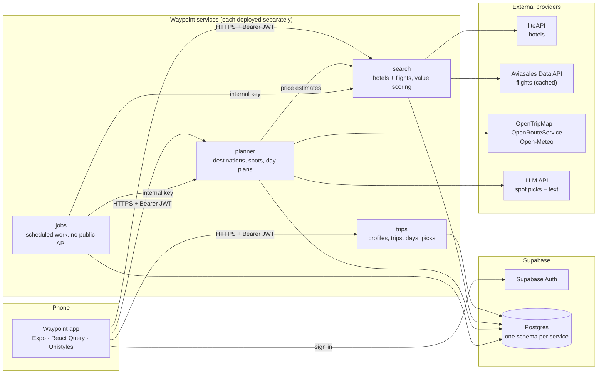
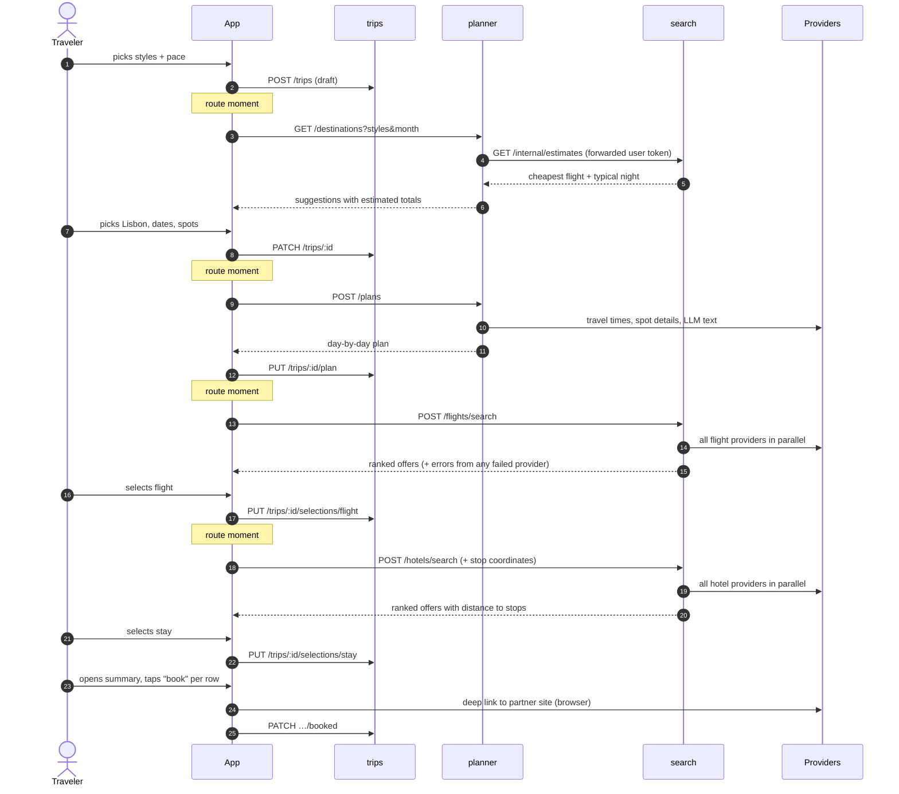
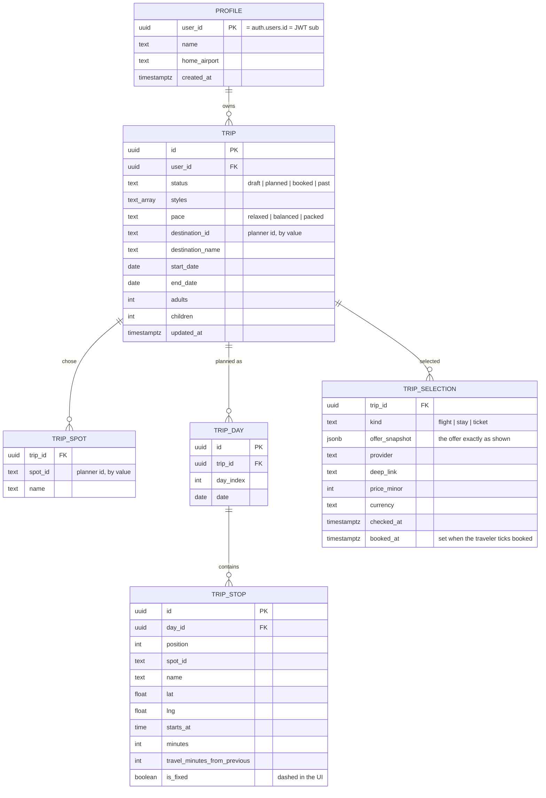
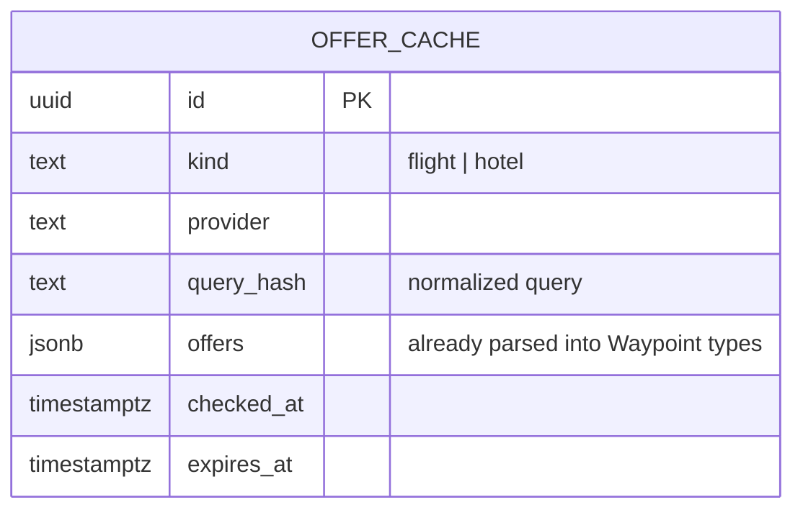
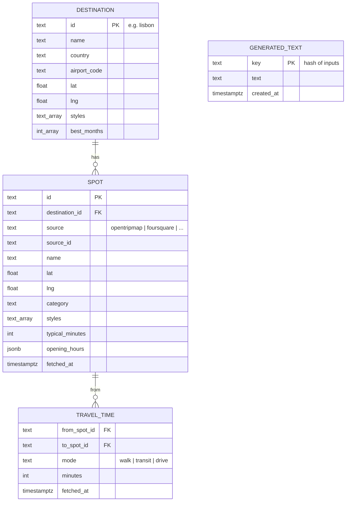
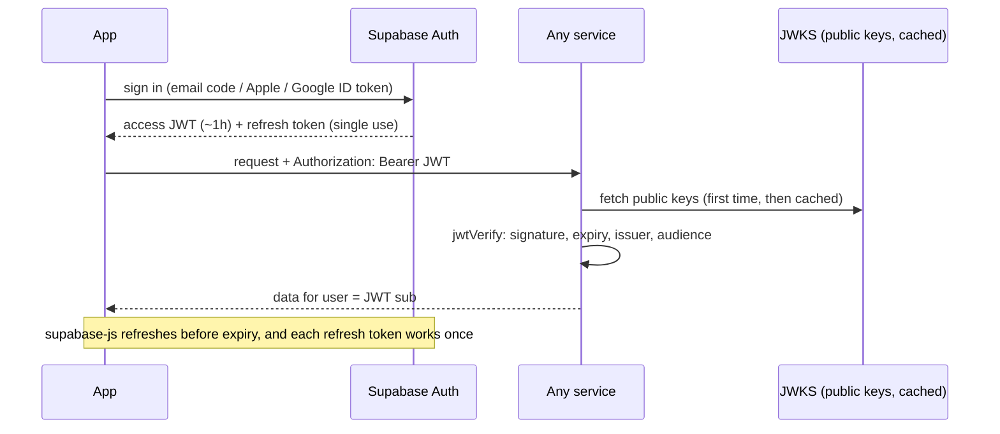
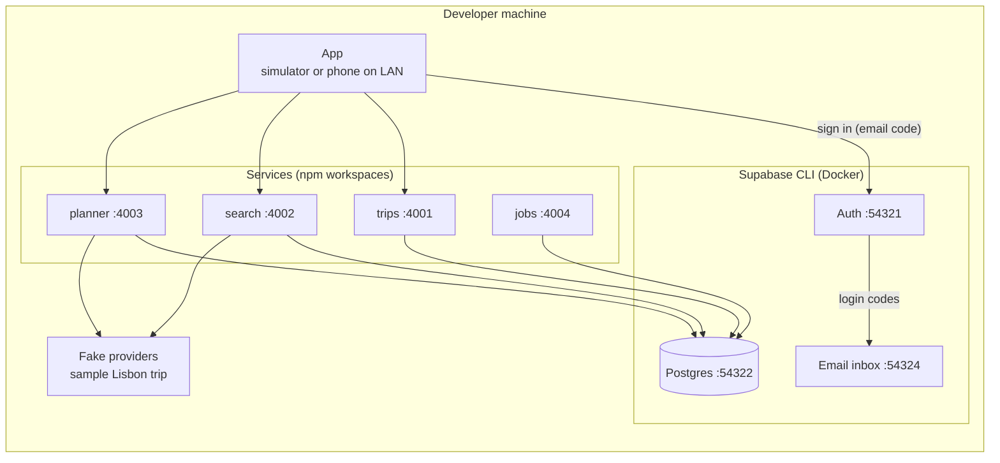
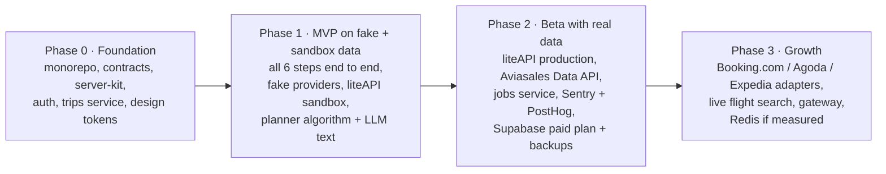

# Waypoint — architecture

Status: **draft v1**, October 2026. Nothing is built yet. Decisions recorded here match the root `CLAUDE.md`; when they disagree, `CLAUDE.md` wins and this file gets fixed.

## 1. Overview

Waypoint plans a whole trip in under five minutes: trip style → destination → spots & dates → day-by-day plan → flights → stay → summary, always steering to the best quality for the money.

In years 1–2 Waypoint **plans and compares only**. It never takes payment; each part is booked on the partner site through a deep link, and Waypoint earns through affiliate programs.

Rules that shape every part of the system:

- **No scraping.** Offer data comes only from official APIs and affiliate programs.
- **Best value, never "who pays more".** Ranking is value-based; anything paid is labelled "Sponsored".
- **Prices show their age.** Every price carries when it was checked ("checked 3h ago") and "final price confirmed on site".
- **The app never calls outside sources directly**, except Supabase Auth for sign-in.

## 2. System map



**Stack:** TypeScript strict everywhere · Expo (React Native, dev builds) · Unistyles 3 · TanStack React Query · Express 5 · Prisma · Supabase (Postgres + Auth) · Zod · npm-workspaces monorepo.

**Repo:**

```
apps/mobile            Expo app
services/trips         Express service
services/search        Express service
services/planner       Express service
services/jobs          Express service (no public routes)
packages/contracts     @waypoint/contracts — Zod schemas + types for every API
packages/server-kit    @waypoint/server-kit — requireUser, requireService, service client, health/errors
```

## 3. Services

Every service: own `package.json`, own Express server, own deployment, own Postgres schema, `GET /health`. Services never import each other's code and never read each other's tables — they call each other's APIs.

### trips — the traveler's saved state

| | |
|---|---|
| **Owns** | `trips` schema: profiles, trips, picks, days, stops, selected offers |
| **Calls** | nothing |
| **Public routes** | `GET /me` · `PATCH /me` · `GET /trips` · `POST /trips` · `GET /trips/:id` · `PATCH /trips/:id` · `DELETE /trips/:id` · `PUT /trips/:id/plan` · `PUT /trips/:id/selections/:kind` · `PATCH /trips/:id/selections/:kind/booked` |

The single source of truth for a trip. Every step's picks are saved here as the traveler goes, so a draft survives closing the app. It stores *results* other services produced (the day plan, the chosen offer as a snapshot) — it never recomputes them.

### search — offers and value

| | |
|---|---|
| **Owns** | `search` schema: offer cache |
| **Calls** | liteAPI, Aviasales Data API (through provider adapters) |
| **Public routes** | `POST /flights/search` · `POST /hotels/search` |
| **Internal routes** | `GET /internal/estimates` (cheapest known flight + typical stay per night for a destination and month) · `POST /internal/cache/refresh` |

Runs the provider adapter contract (see `CLAUDE.md`): every provider behind one function signature, all called with `Promise.allSettled` and a timeout, results parsed into Waypoint's own `FlightOffer` / `HotelOffer`, merged when two providers return the same offer, ranked by value. A merged offer keeps every source, which feeds the "Where we found it" sheet:

```ts
// shape sketch — the real schema lives in @waypoint/contracts
type HotelOffer = {
  readonly hotel: { readonly name: string; readonly lat: number; readonly lng: number; readonly stars?: number }
  readonly bestPrice: Money
  readonly cancellation: 'free' | 'partial' | 'non-refundable'
  readonly sources: ReadonlyArray<{
    readonly provider: ProviderId
    readonly providerOfferId: string
    readonly price: Money
    readonly deepLink: string
    readonly checkedAt: string            // ISO timestamp
  }>
  readonly value: { readonly score: number; readonly savingsVsAverage: Money; readonly isBestValue: boolean }
  readonly distanceToStops?: { readonly averageMeters: number; readonly maxMeters: number }  // when stops were sent
}
```

Each adapter returns single-source offers (one `provider`, `providerOfferId`, `price`, `deepLink`, `checkedAt` each); `mergeSameHotel` folds offers for the same hotel into this shape.

`POST /hotels/search` takes the planned stops' coordinates so it can return distance to the plan and favour well-placed stays.

### planner — where to go and what to do

| | |
|---|---|
| **Owns** | `planner` schema: curated destinations, spots, travel times, generated text |
| **Calls** | `search` (`/internal/estimates`), OpenTripMap / Foursquare, OpenRouteService, Open-Meteo, the LLM API |
| **Public routes** | `GET /destinations?styles=&month=&origin=` · `GET /destinations/:id/spots?styles=&days=` · `POST /plans` · `POST /plans/swap` |

- **Destinations:** a curated list of 50–100 cities tagged by style. Suggestions are matched to the traveler's styles and month, with an estimated total from `search`.
- **Spots:** recommended spots for the destination and styles, with a "fits in N days" check.
- **Day plans — hybrid:** a deterministic algorithm groups spots by area, respects opening hours and travel times, and orders each day; the LLM only picks spots for the traveler's styles and writes descriptions. The algorithm is pure and testable without the LLM. `POST /plans/swap` returns alternatives for one stop.

### jobs — work nobody waits for

| | |
|---|---|
| **Owns** | `jobs` schema: job run log |
| **Calls** | `search` and `planner` internal routes, with the internal service key |
| **Public routes** | none (only `/health`) |

Scheduled work: refresh cached flight prices for popular routes, refresh spot data for curated destinations, delete expired cache rows. Runs as its own small process so background work never slows user requests.

## 4. The user flow → backend calls

Each step saves the traveler's picks to `trips`. The **route moment** between steps (the ~3s full-screen map) covers the slow call for the next step, so the next screen opens with its data ready.

| Step | Screen | Calls | During the route moment *after* this step |
|---|---|---|---|
| 0 | Log in / Home | Supabase Auth · `GET /me` · `GET /trips` | — |
| 1 | Trip style | `POST /trips` (draft) · `PATCH /trips/:id` | `GET /destinations` |
| 2 | Destination | `PATCH /trips/:id` | `GET /destinations/:id/spots` |
| 3 | Spots & dates | `PATCH /trips/:id` | `POST /plans` |
| 4 | Day plan | `POST /plans/swap` (on swap) · `PUT /trips/:id/plan` | `POST /flights/search` |
| 5 | Flights | `PUT /trips/:id/selections/flight` | `POST /hotels/search` (with stop coordinates) |
| 6 | Stay | `PUT /trips/:id/selections/stay` | — |
| 7 | Summary → Trip planned | `GET /trips/:id` · deep links open partner sites · `PATCH …/booked` per row | — |



The app orchestrates the flow; services stay independent. The only user-path call between services is `planner → search` for destination estimates.

## 5. Data model

One Supabase Postgres. Each service owns one schema and its own Prisma migrations. **No foreign keys cross schemas:** a trip stores a destination id or an offer snapshot by value, and the owning service stays free to change its tables.

### `trips` schema



### `search` schema



### `planner` schema



### `jobs` schema

`JOB_RUN (id, job_name, started_at, finished_at, status, error)` — one row per run, for debugging and for not running the same job twice.

Money is stored as integer minor units plus an ISO currency code, never as floats.

## 6. Cross-cutting concerns

### Auth



- Every service uses `requireUser` from `@waypoint/server-kit`. Handlers trust only the verified `sub`.
- Service → service on a user's behalf: forward the same bearer token. `jobs` → service: internal service key, checked by `requireService`.
- Details: root `CLAUDE.md`, "Auth".

### Provider adapters

Every external offer source is one record of functions behind a shared type (`HotelProvider`, `FlightProvider`). Adding Booking.com or Agoda later = one adapter folder + one line in the provider list. Full contract: root `CLAUDE.md`, "Provider adapter contract".

### Price freshness and caching

| Data | Source freshness | Waypoint cache | Shown as |
|---|---|---|---|
| Flight prices (Aviasales Data API) | cached by the provider, up to 7 days | until the provider's `expires_at` | "checked Xh ago" from the provider's timestamp |
| Hotel rates (liteAPI) | live | short (proposed 15 min) per normalized query | "checked X min ago" |
| Destination estimates | derived | refreshed daily by `jobs` | "estimated" |
| Spots, travel times | slow-changing | days to weeks, refreshed by `jobs` | — |
| LLM descriptions | generated | by input hash, until inputs change | — |

Postgres is the cache to start with. Redis comes in only when measured load needs it.

### Failure handling

| What fails | What the traveler sees |
|---|---|
| One provider (e.g. liteAPI times out) | Results from the others, plus "one site didn't respond" |
| All providers for a step | Empty state with retry; picks so far stay saved in `trips` |
| `search` is down | Flights/stay step shows retry; the plan stays saved |
| `planner` is down | Can't create new plans; existing trips still open |
| `trips` is down | App can't save; it keeps the step locally and retries |
| LLM is down | Plan still built by the algorithm, with short default descriptions |

Expected failures are typed results, not thrown exceptions. Service-to-service calls always have a timeout.

### Observability

- Sentry in the app and every service; PostHog for product analytics in the app.
- Each request gets an `x-request-id` (created by the app, forwarded between services) so one traveler action can be traced across services.

### Testing

- Pure logic (value scoring, merging offers, day-plan algorithm) has plain unit tests.
- Every provider adapter passes one shared contract test.
- A **fake provider** returns the sample trip (Tel Aviv → Lisbon, 12–16 May, 2 adults), so the app and services run with no API keys.

### Local development

Development runs fully offline by default: a local Supabase stack plus fake providers. Cloud services are opt-in per service through env vars.



| Piece | Offline | Online (opt-in) |
|---|---|---|
| Database | local Postgres, one schema per service | Supabase cloud |
| Auth | local Auth, email codes in the local inbox | Supabase cloud, plus Google and Apple sign-in |
| Hotels | `HOTEL_PROVIDERS=fake` | `liteapi` (sandbox key) |
| Flights | `FLIGHT_PROVIDERS=fake` | `aviasales` |
| Day-plan text | `LLM_PROVIDER=fake` | the real LLM API |

Commands: `npx supabase start` / `stop`, then each service with its own dev script. Prisma owns migrations (`prisma migrate dev` per service); the Supabase CLI only runs the database. A real phone reaches the services through the computer's local network IP, not `127.0.0.1`. Full rules: root `CLAUDE.md`, "Local development".

## 7. Phased roadmap



Apply to Booking.com, Agoda, Expedia, the Aviasales Search API and Kiwi.com **now**: approvals take time, and each one becomes a Phase 3 adapter.

## 8. Open questions

1. **Hosting** for the four services: Railway or Render. Both charge per running service.
2. **Cache durations:** the 15-minute hotel cache is a proposal; tune it after seeing liteAPI's terms and real traffic.
3. **Currency conversion:** Aviasales prices default to rubles, so the search service needs an exchange-rate source.
4. **LLM provider and model** for spot picks and descriptions.
5. **Spot data quality:** OpenTripMap at launch, or pay for Foursquare / Google Places from the start.
6. **liteAPI fair use:** confirm that search-heavy, booking-light usage is within their terms before launch.
7. **Gateway:** stay with direct app → service calls, or put one gateway in front when the service count or auth needs grow.
