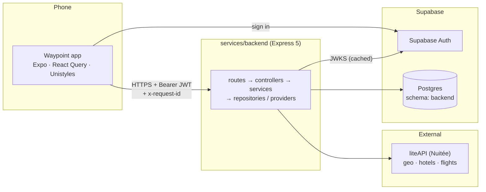
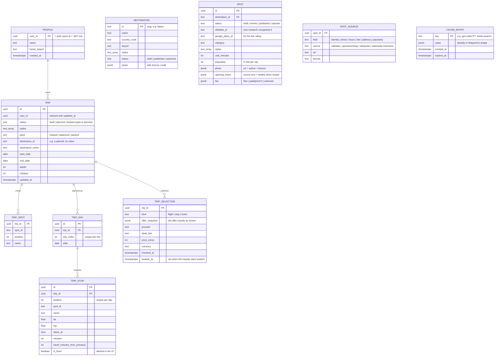
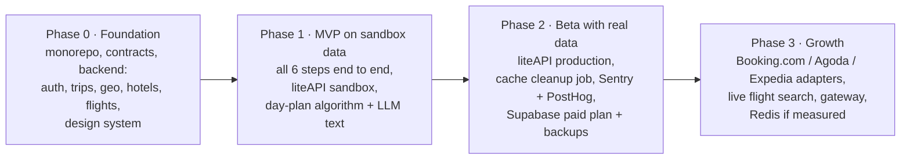

# Waypoint — architecture

Status: **draft v2**, October 2026 — one backend service (`services/backend`), liteAPI as the only external source. Decisions recorded here match the root `CLAUDE.md`; when they disagree, `CLAUDE.md` wins and this file gets fixed.

## 1. Overview

Waypoint plans a whole trip in under five minutes: trip style → destination → spots & dates → flights → stay → day-by-day plan → summary, always steering to the best quality for the money.

In years 1–2 Waypoint **plans and compares only**. It never takes payment; each part is booked on the partner site through a deep link, and Waypoint earns through affiliate programs.

Rules that shape every part of the system:

- **No scraping.** Offer data comes only from official APIs and affiliate programs.
- **Best value, never "who pays more".** Ranking is value-based; anything paid is labelled "Sponsored".
- **Prices show their age.** Every price carries when it was checked ("checked 3h ago") and "final price confirmed on site".
- **The app never calls outside sources directly**, except Supabase Auth for sign-in.

## 2. System map



**Stack:** TypeScript strict everywhere · Expo (React Native, dev builds) · Unistyles 3 · TanStack React Query · Express 5 · TypeORM · Supabase (Postgres + Auth) · Zod · winston · npm-workspaces monorepo.

**Repo:**

```
apps/mobile            Expo app
services/backend       the one Express API
packages/contracts     @waypoint/contracts — Zod schemas + types for every API shape
```

## 3. The backend

| | |
|---|---|
| **Owns** | Postgres schema `backend`: profiles, trips (spots, days, stops, selections), provider cache |
| **Calls** | liteAPI (one adapter: `src/providers/liteapi/`), Supabase JWKS |
| **Layers** | `routes/` → `controllers/` (parse with the contract, map result) → `services/` (rules, `Result`) → `repositories/` (TypeORM) and `providers/` (liteAPI) |

### Routes

Everything except `/health` needs `Authorization: Bearer <Supabase access token>`.

| Area | Route | What |
|---|---|---|
| health | `GET /health` | public liveness |
| me | `GET /me` · `PATCH /me` | profile, created on first call |
| geo | `GET /countries` | every country (ISO-2 + name) |
| | `GET /countries/:countryCode/cities` | cities of a country |
| | `GET /countries/:countryCode/cities/:cityName/prices?from&to` | average hotel price per night, per day (USD estimate) |
| | `GET /places?q=&type=` · `GET /places/:placeId` | place autocomplete and detail (Google Places through liteAPI, cached) |
| | `GET /airports?q=` | airport search |
| destinations | `GET /destinations?styles=` | published destinations ranked by style match, with a stay-per-night estimate |
| | `POST /destinations` `{ placeId }` | a city found by search (`GET /places?type=locality`) → its destination: the curated one if we have it, else one added as `searched` with the city's airport (no spots until researched) |
| | `GET /destinations/:destinationId` · `GET /destinations/:destinationId/spots?styles=` | one destination · its published spots, best style fit first |
| spots | `GET /spots/:spotId` · `GET /spots/:spotId/rating` | one spot · its Google rating, fetched live (never stored) |
| hotels | `GET /hotels?type=place\|city\|coordinates&…&limit&offset` | hotel catalog (no prices) |
| | `GET /hotels/:hotelId` | hotel detail |
| | `POST /hotels/search` | live prices for a stay → ranked `HotelOffer[]` + `errors`; `location` may be `stops` (the trip's spots) |
| flights | `POST /flights/search` | live fares (one way / round trip) → ranked `FlightOffer[]` + `errors` |
| trips | `GET /trips` · `POST /trips` | my trips (each with `planDays`, chosen `selections` and `destinationPhoto` — the destination's current photo, joined at read — so Home can show progress, resume a draft and draw its postcard) · create a draft |
| | `GET /trips/:id` · `PATCH /trips/:id` · `DELETE /trips/:id` | detail (spots, days, selections) · update picks/status · delete |
| | `POST /trips/:id/plan` | build the day plan and save it (or, given each day's spots, re-order and re-time them) |
| | `PUT /trips/:id/plan` | replace the day-by-day plan as given |
| | `PUT /trips/:id/selections/:kind` | choose a flight / stay / ticket (offer snapshot) |
| | `PATCH /trips/:id/selections/:kind/booked` | tick / untick "booked on the partner site" |

Request and response shapes: `packages/contracts/src/<area>/routes.ts`.

### Offers and value

Each provider adapter returns `ProviderHotelOffer` / `ProviderFlightOffer` — one provider each, with `provider`, `providerOfferId`, `price`, `deepLink` and `checkedAt`. `searchAcross` calls every provider in parallel with its own timeout; failures come back as `ProviderError`s beside the offers. The service maps offers to `HotelOffer` / `FlightOffer` (with `sources`, `bestPrice`, `value`) and ranks them with `rankByValue`: quality ÷ (price ÷ median price). Hotel quality is the guest rating, else stars, slightly favouring free cancellation; flight quality is speed versus the fastest itinerary, minus 15% per stop. Exactly one offer is `isBestValue`.

### Trip status

`draft → planned` (needs a destination) `→ booked` (set automatically when any selection is ticked booked, and back to `planned` when none is). `past` is never stored: a non-draft trip whose end date has gone by reads as `past`.

## 4. The user flow → backend calls

Each step saves the traveler's picks. The **route moment** between steps (the ~3s full-screen map) covers the slow call for the next step.

| Step | Screen | Calls | During the route moment *after* this step |
|---|---|---|---|
| 0 | Log in / Home | Supabase Auth · `GET /me` · `GET /trips` | — |
| 1 | Trip style | `POST /trips` (draft) · `PATCH /trips/:id` | `GET /countries`, `GET /places?q=` |
| 2 | Destination | `PATCH /trips/:id` · `GET /countries/:cc/cities/:city/prices` | `GET /places/:placeId` |
| 3 | Spots & dates | `PATCH /trips/:id` (spots, dates) | — |
| 4 | Stay | `POST /hotels/search` (`stops`: the picked spots) · `GET /hotels/:hotelId` · `PUT /trips/:id/selections/stay` | `POST /flights/search` (round trip, the whole party) |
| 5 | Flights | `POST /flights/search` · `PUT /trips/:id/selections/flight` | — |
| 6 | Day plan | `POST /trips/:id/plan` (built during the moment before it; edits send each day's spots) | — |
| 7 | Summary → Trip planned | `PATCH /trips/:id` (`planned`) · `GET /trips/:id` · deep links · `PATCH …/booked` per row | — |

Flights come right after the dates are set, then the stay (near the spots), and the day plan last: it starts each day from the stay, and flight times shorten the first and last days.

A stay search by `stops` looks around the spots' geometric median (wide enough for 80% of them, 1–5 km) and scales each hotel's quality by how near it is to them against the other hotels found (`services/hotelLocation.logic.ts`; travel minutes are estimated in `lib/travel.ts`, which the day planner will share). Each offer carries `stopsMinutes` (the median, so one far spot doesn't count against a central hotel) and one has `isBestLocation`.

The day plan is built on the server by a deterministic planner (`services/planner/`): each day's room (09:30–21:00, the pace's budget, shortened by landing and leaving, with landing, check-in, the airport run and the flight home as fixed stops); regret insertion to group the spots into days (hardest to place first, opening hours and budget respected), a swap-in of more popular spots that were dropped, then moves and 2-opt reversals while they cut travel and even out the days; each day is timed with a lunch break, waits for opening, and walk or transit between stops (`lib/travel.ts`). Spots that don't fit are the trip's spots not in the plan. An edit (a spot removed or moved) sends each day's spots and the planner only re-orders and re-times them.

## 5. Data model

One Supabase Postgres; the backend owns the `backend` schema and its TypeORM migrations (`services/backend/src/db/migrations/`). Provider data is stored **by value** — a trip keeps a destination id and an offer snapshot exactly as shown — so a provider changing its ids or prices never rewrites a saved trip. Nothing references Supabase's `auth` schema by foreign key.

### `backend` schema



Child rows are deleted with their trip (`ON DELETE CASCADE`). Money is stored as integer minor units plus an ISO currency code, never as floats.

## 6. Cross-cutting concerns

### Auth


- `requireUser` (`middleware/requireUser.ts`) guards every route but `/health`. Handlers trust only the verified `sub`; another user's trip answers 404, never 403.
- Details: root `CLAUDE.md`, "Auth".

### Provider adapters

Every external source is one record of functions behind a shared type (`GeoSource`, `HotelCatalog`, `HotelProvider`, `FlightProvider` in `providers/types.ts`). Adding Booking.com or Agoda later = one adapter folder + one line in the provider list. Full contract: root `CLAUDE.md`, "Provider adapter contract".

### Spot research

Spots are Waypoint's own data, researched ahead of time per curated city and reviewed before they're shown: `npm run research -w services/backend -- <city>` drafts them (Wikidata for what and where, OpenStreetMap for hours, fee and address, Wikimedia Commons for photos with their licence credit, Wikipedia page views for popularity) and `-- <city> --publish` publishes the reviewed drafts. Re-running refreshes popularity, hours, fees and photos but never what a reviewer owns. Google ratings are never stored: the spot keeps only its Google place id and the rating is fetched live.

### Price freshness and caching

| Data | Source | Cached for | Shown as |
|---|---|---|---|
| Countries, cities, places, airports | liteAPI data (Places is paid per call) | 30 days | — |
| City price index | liteAPI `/prices/city` (USD, historical) | 1 day | "about $X a night" (estimate) |
| Hotel catalog / detail | liteAPI static data | 7 days | — |
| Hotel rates | liteAPI live | 15 min per normalized query | "checked X min ago" |
| Flight fares | liteAPI live | 15 min per normalized query | "checked X min ago" |

Postgres (`cache_entries`) is the cache. Failures and partial searches are never cached. Redis comes in only when measured load needs it.

### Failure handling

| What fails | What the traveler sees |
|---|---|
| One search provider fails | Results from the others, plus `errors` ("one site didn't respond") |
| liteAPI times out on a lookup | `504 upstream-timeout` — retry |
| liteAPI errors on a lookup | `502 upstream-unavailable` — retry |
| The cache table misbehaves | Logged; the request goes to liteAPI as if nothing were cached |
| The backend is down | App can't save; it keeps the step locally and retries |

Expected failures are typed results (`ServiceError`, `ProviderFailure`), not thrown exceptions. Every liteAPI call has a timeout.

### Observability

- **Request context:** the app sends `x-request-id`; the backend reuses it (or makes one), echoes it, and keeps it — plus the verified `userId` — in an AsyncLocalStorage context. Every log line carries both: service logs, `upstream call` (liteAPI method, path, status, duration), DB query errors and slow queries, the per-request `http request` access line, and `unhandled error` with its stack.
- **Format:** winston; `LOG_FORMAT=json` (one object per line) in deployed environments, `pretty` locally. Tokens, keys, query strings and bodies are never logged.
- Later: Sentry in the app and backend; PostHog for product analytics in the app.

### Testing

- Pure logic (value scoring, trip rules, offer mapping) has plain unit tests.
- Each liteAPI adapter is tested against a fake `fetch` returning the sample trip (Tel Aviv → Lisbon, 12–16 May, 2 adults) in liteAPI's raw shape — no API key.
- The HTTP surface is tested with supertest against `createApp` with fake services and a local JWKS; the database layer end to end against local Supabase.

### Local development

Development runs against a local Supabase stack (Docker) and the liteAPI sandbox.

| Piece | Local | Deployed |
|---|---|---|
| Database | local Postgres, schema `backend` | Supabase cloud (pooled URL at runtime, direct URL for migrations) |
| Auth | local Auth, email codes in the local inbox | Supabase cloud, plus Google and Apple sign-in |
| liteAPI | sandbox key | production key |

Commands: `npx supabase start`, `npm run migrate -w services/backend`, `npm run dev`. A real phone reaches the backend through the computer's local network IP, not `127.0.0.1`. Full rules: root `CLAUDE.md`, "Local development".

## 7. Phased roadmap



Phases 0 and 1 are broken into parallel tracks, with owned paths and done-states, in `docs/build-plan.md`.

Apply to Booking.com, Agoda, Expedia, the Aviasales Search API and Kiwi.com **now**: approvals take time, and each one becomes a Phase 3 adapter.

## 8. Open questions

1. **Hosting** for the backend: Railway or Render.
2. **Cache durations:** the 15-minute hotel cache is a proposal; tune it after seeing liteAPI's terms and real traffic.
3. **Currency conversion:** the city price index is USD only; showing it in EUR needs an exchange-rate source.
4. **LLM provider and model** for spot picks and descriptions.
5. **Spot data quality:** OpenTripMap at launch, or pay for Foursquare / Google Places from the start.
6. **liteAPI fair use:** confirm that search-heavy, booking-light usage is within their terms before launch.
7. **Gateway:** stay with direct app → service calls, or put one gateway in front when the service count or auth needs grow.
8. **Flight deep links:** liteAPI documents white-label deep links for hotels only; confirm the flights page format with Nuitée.
9. **Day-plan text:** the plan is deterministic; descriptions written by an LLM (a "why this day" line) are not in yet.
